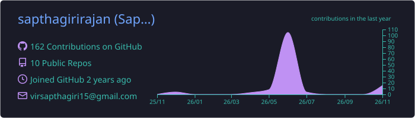
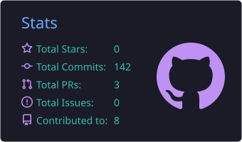
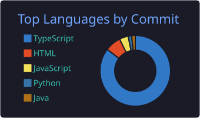

<!-- ═══════════════════════════════════════════════════════════
     Sapthagiri Rajan Rajamanickam · "NEURAL NEON" profile v5
     Banners & cards are self-hosted SVGs in /assets (no Vercel)
     ═══════════════════════════════════════════════════════════ -->

<div align="center">




<b>&nbsp;Hi there, I'm Sapthagiri Rajan Rajamanickam&nbsp;</b>


<a href="https://github.com/sapthagirirajan">
  
</a>


</div>


## ⚡ `./initialize.sh`

```console
┌──(sapthagiri㉿neural-core)-[~/profile]
└─$ ./initialize.sh --verbose

[ OK ] Loading checkpoint ........... sapthagiri-rajan-r v5.0
[ OK ] Architecture ................. AI/ML Engineer × Full-Stack Dev × Cloud & DevSecOps
[ OK ] Education .................... 4th-year B.Tech CSE (AI & ML)
[ OK ] Core modules ................. GenAI · LLMs · RAG · AI Agents · MCP
[ OK ] Product layer ................ React · Node.js · FastAPI · REST APIs
[ OK ] Infra layer .................. Docker · CI/CD · AWS · Linux
[ OK ] Shield layer ................. Burp Suite · Wireshark · OWASP ZAP
[WARN] Coffee level ................. critical — refill recommended ☕
[ OK ] Status ....................... READY TO BUILD 🚀
```


### 🧠 About Me

- 🎓 4th-year **B.Tech CSE (AI & ML)** student
- 🤖 Building with **Generative AI, LLMs & RAG**
- 💻 Full-stack developer focused on **useful, polished products**
- ☁️ Deploying with **Docker, CI/CD & cloud** — security baked in
- 🔐 Hands-on with **secure coding & DevSecOps**

### 💭 Philosophy

> **"Innovation lies at the intersection of code, intelligence, and creativity."**
> I build solutions that don't just solve problems — they inspire the next wave of AI-driven transformation.

<br clear="right"/>

### 🎯 2027 Mission

| 🚀 Ship | 🧠 Master | 🌱 Grow |
|:--|:--|:--|
| Production-ready GenAI apps | Reliable RAG systems & AI agents | Cloud, Docker, CI/CD & deployment |
| A full-stack product, idea → launch | Evaluation & responsible AI | Open-source contributions |
| Technical projects, demos & notes | DSA · SQL · System Design | A strong AI/ML or full-stack role |


## 🛠️ Neural Toolkit

<div align="center">

<table>
<tr>
<td align="center" width="50%">

**💻 Languages**<br/><br/>


</td>
<td align="center" width="50%">

**🌐 Frameworks**<br/><br/>


</td>
</tr>
<tr>
<td align="center">

**🤖 AI / ML Core**<br/><br/>


</td>
<td align="center">

**☁️ Cloud & DevOps**<br/><br/>


</td>
</tr>
<tr>
<td align="center">

**🗄️ Data & Frontend**<br/><br/>
<br/>


</td>
<td align="center">

**🛡️ Security & Tooling**<br/><br/>
<br/>


</td>
</tr>
</table>

</div>

```diff
+ Generative AI   ▸ LLMs · RAG · Vector Search · AI Agents · MCP · Prompt Engineering
+ AI / ML         ▸ PyTorch · TensorFlow · Scikit-learn · Pandas · OpenCV · YOLO
+ Development     ▸ Python · Java · React · Node.js · FastAPI · REST APIs
! Cloud & DevOps  ▸ Docker · GitHub Actions · AWS · Linux · Nginx
- Security        ▸ Burp Suite · Wireshark · OWASP ZAP · Secure Coding
```


## 🚀 Project Constellation

<div align="center">

<a href="https://github.com/sapthagirirajan"></a>
<a href="https://github.com/sapthagirirajan"></a>
<a href="https://github.com/sapthagirirajan"></a>
<a href="https://github.com/sapthagirirajan"></a>

</div>

### 🌟 Learning & Contributing

- 🧩 **Open Source AI/ML** — contributing to Python & JS-based AI tools
- 🐍 **Python Security Tools** — custom automation scripts
- 🌐 **Web Development** — MERN stack & modern full-stack apps
- 🌍 **AI for Social Good** — applying AI to impactful problems


## 📚 Training Log — Currently Learning

<details>
<summary><b>🤖 Artificial Intelligence</b> &nbsp;<sub>(click to expand)</sub></summary>
<br/>

- Deep Learning & Neural Networks
- Computer Vision & Natural Language Processing
- Generative AI, LLM applications & prompt design
- Retrieval-Augmented Generation (RAG) & vector search
- AI agents, tool calling & Model Context Protocol (MCP)
- Reinforcement Learning
- Model optimization, deployment, evaluation & observability

</details>

<details>
<summary><b>📈 Machine Learning</b></summary>
<br/>

- Supervised & Unsupervised Learning
- Data Preprocessing & Feature Engineering
- Model Evaluation & Tuning
- ML Pipelines & Automation
- Responsible & Ethical AI Practices

</details>

<details>
<summary><b>💻 Development</b></summary>
<br/>

- MERN Stack Projects
- Next.js, TypeScript & modern full-stack architecture
- Python for AI/ML & Automation
- Secure Full-Stack Coding, API Security & DevSecOps

</details>

<details>
<summary><b>☁️ Infrastructure</b></summary>
<br/>

- Docker & CI/CD Integration
- AWS Cloud Security Basics
- Linux System Administration
- Cloud-Native Application Security

</details>

### 🔮 Roadmap 2027

```text
PHASE 01 ▸ BUILD     ██████████░░░░░░░░░░  50%   End-to-end GenAI/RAG project · production-style full-stack app
PHASE 02 ▸ SHARPEN   ████████░░░░░░░░░░░░  40%   AWS/Azure fundamentals · DSA · SQL · System Design
PHASE 03 ▸ PUBLISH   ██████░░░░░░░░░░░░░░  30%   5+ AI/ML projects · demos · blogs & tutorials
PHASE 04 ▸ LAUNCH    ████░░░░░░░░░░░░░░░░  20%   Internship / industry project · AI/ML or full-stack role
```


## 📊 Evaluation Metrics

<div align="center">

<!-- Generated daily into this repo by .github/workflows/profile.yml -->






<picture>
  <source media="(prefers-color-scheme: dark)" srcset="https://raw.githubusercontent.com/sapthagirirajan/sapthagirirajan/output/github-contribution-grid-snake-dark.svg" />
  
</picture>

</div>


## 🌐 Connect & Collaborate

<div align="center">

<a href="mailto:sapthagirirajan@gmail.com"></a>
<a href="https://linkedin.com/in/sapthagirirajan"></a>
<a href="https://x.com/sapthagirirajan"></a>
<a href="https://dev.to/sapthagirirajan"></a>
<a href="https://github.com/sapthagirirajan"></a>

<br/><br/>

| 🎯 Open to collaborate on | |
|:--|:--|
| 🤖 AI & ML (Deep Learning · NLP · CV) | 🌐 Full-Stack Web (MERN · Python) |
| 🧠 GenAI · RAG · AI Agents | ☁️ Cloud Security & DevSecOps |
| 📚 Technical Writing | 🚀 AI for Social Good |
| 💼 AI/ML/Full-Stack Internships | 🤝 Study Groups & Communities |

<br/>



</div>
